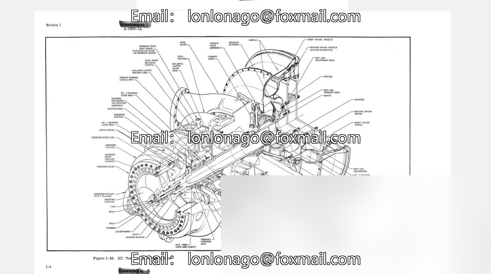
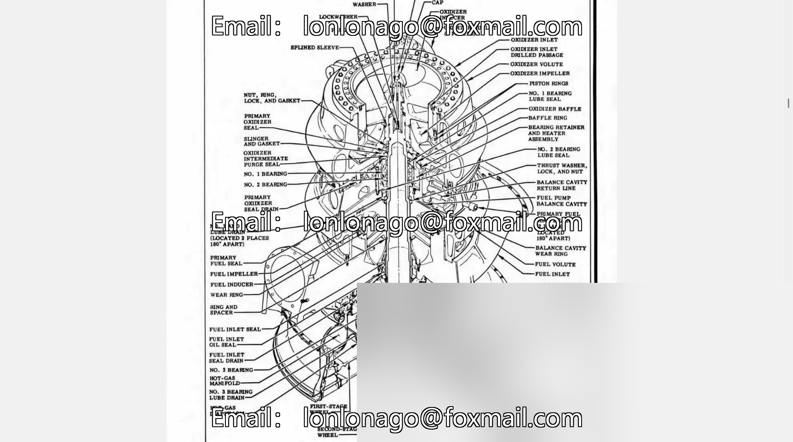
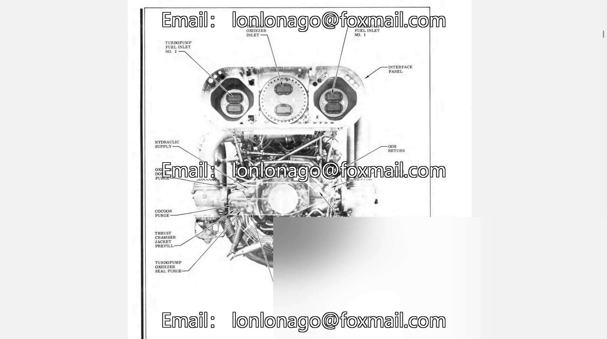
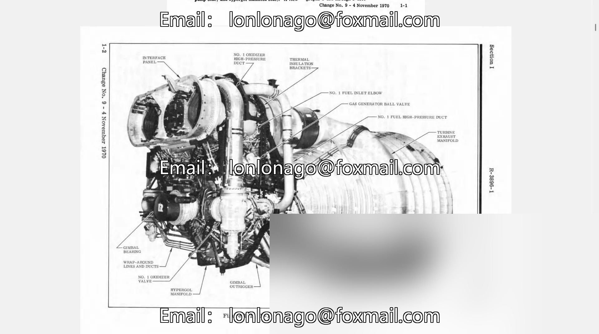

# Inception Public Rocket Lattin Company F-1 rocket engine technical documentation set, R3896 series

## Body

The technical documentation set of Huipian Locktard Engine Co., Ltd. F-1 rocket engine, R3896 series, 21 volumes, including complete manuals and training materials.
The contents of the documents cover engine structure, working principles, maintenance and protection, testing methods, etc., suitable for professionals such as aerospace engineering, rocket engine technology research, and maintenance training.
Installation: R3896-6_INSTALLATION

Operation: R3896-11_OPERATING_INSTRUCTIONS and R8257_Prelaunch_Op...

Maintenance: R3896-5_GROUP REPLACEMENT & MAINTENANCE

Transportation: R3896-9_TRANSPORTATION. , non-refundable upon sale.

The collection covers F-1 rocket engine R3896 series technical materials, including engine structure, working principles, maintenance, testing methods, installation, operation, maintenance, transportation and a no-refund policy.

<!-- AI_ENRICHED -->

## Images

## Payment

Here is a pay link on Stripe ( https://buy.stripe.com/3cs8yP7sY87d0vu9AB ). Please contact me lonlonago@foxmail.com after funding $89, and I will send you a complete data files , thank you!

